# 📺 ruv-dl

### Download media content from ruv.is

`ruv-dl` is a simple Python command-line  tool to download media content from [RÚV](https://ruv.is).

## ✨ Features

🔹 FFmpeg wrapper to download TV and radio programs from ruv.is given a provided URL

🔹 Optionally include metadata that is used by RÚV, such as images, text description and subtitle files

🔹 Choose between resolutions offered by RÚV and file formats supported by FFmpeg

## ⚡️ Installation

Clone the repository to install `ruv-dl`:

`$ git clone https://github.com/thrkll/ruv-dl`

Install dependencies:

`$  pip install -r requirements.txt`

## ⚙️ Requirements

Python 3.6+

[FFmpeg](https://ffmpeg.org/download.html) in path

## 📖 Usage

### Basic download

Find the link to whatever it is you want to waste your time on and paste the URL after the input argument `-i`. 

`$ python ruv-dl.py -i https://ruv.is/sjonvarp/spila/sample/30726/950qj1`

### Resolution

By default, `ruv-dl` downloads the highest resolution RÚV offers for the program. To download a smaller file, use the `-r` argument. RÚV streams come in several quality variants. `ruv-dl` ranks the available ones by resolution, highest first: `1` (default) picks the highest, `2` the second-highest and `3` the third-highest. The exact resolutions and bitrates depend on what RÚV provides for each program. If fewer variants exist, the lowest available one is used. `-r` has no effect on audio-only content such as radio.

`$ python ruv-dl.py -i https://ruv.is/sjonvarp/spila/sample/30726/950qj1 -r 2`

### Folder structure

If you are fancy 🎩 - make sure to include the `-f` argument. This will bundle the media file in a fancy folder together with all images and text description provided by RÚV. Image filenames comply with naming conventions used by Plex, Jellyfin, Emby and more. 

`$ python ruv-dl.py -i https://ruv.is/sjonvarp/spila/sample/30726/950qj1 -f`

### Subtitles

Most video content on ruv.is comes with Icelandic :iceland: subtitles. `ruv-dl` will attempt to download these files and convert them to .srt files. To include them in the download, use the `-s` argument.

`$ python ruv-dl.py -i https://ruv.is/sjonvarp/spila/sample/30726/950qj1 -f -s`

### Filetypes

By default, all files will download as .mp4. But for the true snob, `ruv-dl` can use any file format supported by FFmpeg. Use the `-t` argument to specify the format.

`$ python ruv-dl.py -i https://ruv.is/sjonvarp/spila/sample/30726/950qj1 -t mkv`

### Different FFmpeg location 

In the optimal setup, FFMpeg will be available in the `$PATH`. Alternatively you can specify the location of the FFmpeg installation folder using the `-l` argument. 

`$ python ruv-dl.py -i https://ruv.is/sjonvarp/spila/sample/30726/950qj1 -l C:/ffmpeg/`

Note that depending on your FFmpeg build, you might need to link to `../ffmpeg/bin`.

### Help

When you eventually forget everything you've read here, you can use the `--help` argument.

## 🧪 Tests

Tests run without network access and use only the standard library. If FFmpeg is installed, a few extra tests generate tiny HLS streams locally and download them for real.

`$ python -m unittest discover -s tests`

## ⚒️ Project assistance

Please raise an issue if you have a feature request or run into trouble (not unlikely given frequent changes at ruv.is.) Feel free to contribute and make pull requests. Mark the project with a star ⭐ if you like it.

## 🚚 Versions

📦 2.1.3 - 2025 06 - Default image filenames updated for media server compatibility

📦 2.1.0 - 2023 02 - Complete refactoring, new features added

📦 2.0.0 - 2023 01 - CLI version of ruv-dl with argparse

📦 1.0.0 - 2019 09 - Initial release

## ⚠️ Licence

MIT License

Copyright (c) 2025 Þorkell Einarsson

Permission is hereby granted, free of charge, to any person obtaining a copy
of this software and associated documentation files (the "Software"), to deal
in the Software without restriction, including without limitation the rights
to use, copy, modify, merge, publish, distribute, sublicense, and/or sell
copies of the Software, and to permit persons to whom the Software is
furnished to do so, subject to the following conditions:

The above copyright notice and this permission notice shall be included in all
copies or substantial portions of the Software.

THE SOFTWARE IS PROVIDED "AS IS", WITHOUT WARRANTY OF ANY KIND, EXPRESS OR
IMPLIED, INCLUDING BUT NOT LIMITED TO THE WARRANTIES OF MERCHANTABILITY,
FITNESS FOR A PARTICULAR PURPOSE AND NONINFRINGEMENT. IN NO EVENT SHALL THE
AUTHORS OR COPYRIGHT HOLDERS BE LIABLE FOR ANY CLAIM, DAMAGES OR OTHER
LIABILITY, WHETHER IN AN ACTION OF CONTRACT, TORT OR OTHERWISE, ARISING FROM,
OUT OF OR IN CONNECTION WITH THE SOFTWARE OR THE USE OR OTHER DEALINGS IN THE
SOFTWARE.
